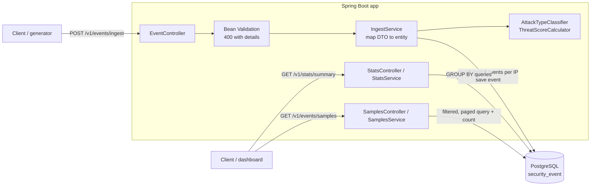

# Mini WSA – Mini Security Analytics Pipeline

A small Web Security Analytics service that ingests security events (DLRs),
classifies and scores them, stores them in PostgreSQL, and exposes analytics through a REST API.

**Stack:** Java 21, Spring Boot 4, Spring Data JPA (Hibernate), Flyway, PostgreSQL 16, Bean Validation,
JUnit 5, Mockito, Testcontainers, Docker Compose.

---

## Contents

- [Quick start](#quick-start)
- [Build and run](#build-and-run)
- [API](#api)
- [Data generator](#data-generator)
- [Demo and check scripts](#demo-and-check-scripts)
- [Architecture](#architecture)
- [Storage choice](#storage-choice)
- [Design decisions](#design-decisions)
- [Testing](#testing)
- [What I would improve with more time](#what-i-would-improve-with-more-time)
- [Challenges and how I solved them](#challenges-and-how-i-solved-them)

---

## Quick start

### Requirements

| Tool | Needed for |
|---|---|
| Docker (Docker Desktop on Mac/Windows), running | The app and PostgreSQL |
| Java 21 | The data generator and `./mvnw test` (Maven itself is downloaded by `mvnw`) |
| `curl`, `python3` | The demo and check scripts (already on macOS and Linux) |

Ports **8080** (app) and **5432** (PostgreSQL) must be free.

### Run

```bash
# 1. Get the code
git clone https://github.com/chen-levin/mini-wsa.git
cd mini-wsa

# 2. Start PostgreSQL and the app (the first build takes a few minutes)
docker compose up -d --build

# 3. Send 10,000 generated events (60 attack waves + background traffic)
java generator/EventGenerator.java 10000 --send

# 4. Look at the results
./scripts/demo-cases.sh | less
```

The API is now on `http://localhost:8080`.

`docker compose up` reads `docker-compose.yml` in the current folder: it builds the app image from the
`Dockerfile` (the code is compiled inside Docker, so the app itself needs no local Java), starts the official
`postgres:16` image (which creates the `miniwsa` database and user on first start), waits until PostgreSQL is
healthy, then starts the app. On startup, Flyway creates the tables.

---

## Build and run

### Option 1: everything in Docker

```bash
docker compose up -d --build     # build the app image and start PostgreSQL + app
docker compose ps                # both services should be up, postgres "healthy"
docker compose logs -f app       # follow the app logs
docker compose down              # stop (keeps the data)
docker compose down -v           # stop and delete the data
```

The app waits until PostgreSQL is healthy, then Flyway creates or updates the schema on startup.

### Option 2: PostgreSQL in Docker, app with Maven (for development)

```bash
docker compose up -d postgres
./mvnw spring-boot:run
```

### Tests

```bash
./mvnw test
```

Docker must be running: the integration tests start a temporary PostgreSQL with Testcontainers.

---

## API

All errors use the same body:

```json
{ "status": 400, "error": "Validation failed", "details": ["[0].rule.severity: must not be null"] }
```

### `POST /v1/events/ingest`

Accepts **one event** or **an array of events**. Each event is validated, classified and scored, then stored
with a server-side `receivedAt`. A batch is stored all-or-nothing.

```bash
curl -H 'Content-Type: application/json' -d @scripts/examples/event.json http://localhost:8080/v1/events/ingest
```

```json
{ "ingested": 1 }
```

| Status | When |
|---|---|
| 201 | Stored |
| 400 | Missing or invalid fields, unknown enum value, bad timestamp, malformed JSON, empty array |

**Required fields:** `eventId`, `timestamp`, `configId`, `clientIp`, `hostname`, `path`, `method`, `statusCode`,
`rule.id`, `rule.severity`, `rule.category`, `action`.
**Optional:** `policyId`, `userAgent`, `rule.name`, `rule.message`, `geoLocation`, `requestSize`, `responseSize`.

Validation details name the exact event and field, e.g. `[1].rule.severity: must not be null` or
`[0].action: Cannot deserialize ... "BLOCK": not one of the values accepted ... [MONITOR, DENY, ALERT]`.

### `GET /v1/stats/summary`

| Parameter | Required | Meaning |
|---|---|---|
| `from`, `to` | yes | ISO-8601 time range, `[from, to)` |
| `configId` | no | Omitted = all configurations |

```bash
curl "http://localhost:8080/v1/stats/summary?configId=14227&from=2026-05-20T00:00:00Z&to=2026-05-21T00:00:00Z"
```

```json
{
  "configId": 14227,
  "timeRange": { "from": "2026-05-20T00:00:00Z", "to": "2026-05-21T00:00:00Z" },
  "totalEvents": 1523,
  "byCategory": {
    "INJECTION": { "count": 450, "avgThreatScore": 72.3 },
    "BOT": { "count": 380, "avgThreatScore": 45.1 },
    "...": "all 7 categories, 0 when none"
  },
  "byAction": { "DENY": 890, "ALERT": 433, "MONITOR": 200 },
  "topAttackers": [ { "clientIp": "203.0.113.42", "count": 87, "avgThreatScore": 81.2 } ],
  "topTargetedPaths": [ { "path": "/api/v1/login", "count": 234 } ]
}
```

- `topAttackers` and `topTargetedPaths`: top 10 by event count.
- All 7 categories and all 3 actions are always present (0 when there are no events).
- Averages are rounded to one decimal.
- 400 when `from`/`to` is missing, not a valid date, or `from` is not before `to`.

### `GET /v1/events/samples`

| Parameter | Default | Meaning |
|---|---|---|
| `configId`, `category`, `action` | – | Optional filters |
| `from`, `to` | – | Optional time range `[from, to)` |
| `limit` | 20 | Page size, 1–100 |
| `offset` | 0 | Events to skip |

```bash
curl "http://localhost:8080/v1/events/samples?category=INJECTION&action=DENY&limit=2&offset=0"
```

```json
{
  "total": 219,
  "limit": 2,
  "offset": 0,
  "events": [
    {
      "eventId": "evt-00132",
      "timestamp": "2026-05-20T14:32:10Z",
      "receivedAt": "2026-10-17T12:23:10.888Z",
      "configId": 14227,
      "clientIp": "203.0.113.42",
      "path": "/api/v1/login",
      "rule": { "id": "950001", "name": "SQL_INJECTION", "severity": "CRITICAL", "category": "INJECTION", "...": "..." },
      "action": "DENY",
      "geoLocation": { "country": "CN", "city": "Beijing" },
      "attackType": "SQL/Command Injection",
      "threatScore": 75,
      "...": "all other DLR fields"
    }
  ]
}
```

- Sorted newest first. `total` is the number of matching events, for pagination.
- Events come back in the same nested shape as the input, plus `attackType`, `threatScore` and `receivedAt`.
- 400 for `limit` outside 1–100, negative `offset`, unknown `category`/`action`, bad dates, or `from` not before `to`.

### Enrichment rules

| `rule.category` | `attackType` |
|---|---|
| INJECTION | SQL/Command Injection |
| XSS | Cross-Site Scripting |
| PROTOCOL_VIOLATION | Protocol Anomaly |
| DATA_LEAKAGE | Data Exfiltration |
| BOT | Bot Activity |
| DOS | Denial of Service |
| RATE_LIMIT | Rate Limiting |

**Threat score** (0–100):

| Part | Points |
|---|---|
| Severity | CRITICAL 40, HIGH 30, MEDIUM 20, LOW 10 |
| Action | DENY +20, ALERT +10, MONITOR +0 |
| Path contains `/admin` or `/login` | +15 |
| More than 5 events from the same `clientIp` in the 10 minutes before this event | +15 |
| Cap | 100 |

The repeat-offender window is based on the event's own `timestamp`, so generated or late events are scored
correctly. With these rules the maximum is 90, so the cap is a safeguard for future rules.

---

## Data generator

`generator/EventGenerator.java` is a single-file Java program (JDK only, no build) that creates realistic events:

- **Attack waves (30%)**: one IP from `198.51.100.x` hitting one path (`/login`, `/api/v1/login`, `/admin`, `/search`)
  with one burst-type rule (injection, bot, DoS, rate limit): 50 events, 5 seconds apart.
- **Background traffic (70%)**: random IPs (about 500 from `203.0.113.x` and `192.0.2.x`), paths, rules, sites and locations.
- All events fall within the last 6 hours and are sorted by time.

```bash
java generator/EventGenerator.java 10000 events.json      # write a JSON array to a file
java generator/EventGenerator.java 10000 --send           # POST to http://localhost:8080 in batches of 500
java generator/EventGenerator.java 10000 --send http://other-host:8080
```

All IPs are from ranges reserved for documentation.

**Number of events:** to generate a different number, pass it as the first argument in the command, for example
`java generator/EventGenerator.java 50000 --send`.

---

## Demo and check scripts

Run from the project root, against a running app with generated data. They need `curl` and `python3`.

| Script | Purpose |
|---|---|
| `scripts/demo-api.sh` | Walkthrough of all three APIs: each curl command and its full response |
| `scripts/demo-cases.sh` | 17 stats and samples cases (filters, paging, empty results, errors) with full responses |
| `scripts/check-stats.sh` | 21 PASS/FAIL checks on the stats API (totals add up, sorting, zero-filling, 400s) |
| `scripts/check-samples.sh` | 24 PASS/FAIL checks on the samples API (paging, filters, enrichment, 400s) |
| `scripts/compare-ingest.sh` | Times the same events in one request vs in batches of 500 (empties the table first) |

Every printed command can be copied and run on its own. Set `BASE_URL` to target another host.

---

## Architecture



**Packages:**

| Package | Contents |
|---|---|
| `event` | Ingest endpoint, request DTOs (records), `SecurityEvent` entity, repository |
| `enrichment` | `AttackTypeClassifier`, `ThreatScoreCalculator`: pure functions, unit tested |
| `stats` | Summary endpoint, aggregation queries, response records |
| `samples` | Samples endpoint, filtered and paged queries, response records |
| `error` | `GlobalExceptionHandler`: one error format for all 400s |

**Ingest flow, per request:** validate every event (400 if any is invalid) → in one transaction, for each event:
classify, count events from the same IP in the previous 10 minutes, score, save → 201.

---

## Storage choice

**PostgreSQL**, one flat table, `security_event`.

- The queries are filters on config and time plus `GROUP BY` counts and averages: plain SQL that PostgreSQL does well.
- Reliable, well known, easy to run in Docker, well supported by Spring, Flyway and Testcontainers.
- Plenty for this assignment's data volume (tens of thousands of events).

**At real big-data scale** (billions of events), aggregations on one row-oriented table get slow. I would use a
**columnar store such as ClickHouse** (or Druid / Pinot): it reads only the columns a query needs, compresses well,
and is built for `GROUP BY` over huge event tables. I would also partition by time and expire old data.

---

## Design decisions

### Database: one flat table, indexes that match the queries

- **Flat table.** The nested `rule` and `geoLocation` objects are stored as `rule_*` and `geo_*` columns, so they
  can be filtered, grouped and indexed directly, with no joins. Events are written once and only read, so the
  duplication is safe.
- **Surrogate key.** `id` is a `BIGINT` generated by the database. The client's `eventId` is stored but not unique,
  since clients can send the same id twice.
- **Types.** Enums are stored as `VARCHAR` and validated in the application; times are `TIMESTAMPTZ`. The JSON
  `timestamp` is stored as `event_time`, because `timestamp` is an SQL keyword.
- **Flyway owns the schema.** `V1` creates the table, `V2` adds the enrichment columns; Hibernate only validates
  that the entity matches.

Each index matches a query the service runs:

| Index | Used by |
|---|---|
| `(config_id, event_time)` | Stats and samples filtered by config and time range |
| `(event_time)` | Stats and samples without a config; samples ordering |
| `(client_ip, event_time)` | The repeat-offender count, run for every ingested event |

A two-column index is sorted by its first column, so `(config_id, event_time)` can't serve a time range across all
configs; that is why `(event_time)` exists as well.

### Separate controllers and endpoints

Each endpoint has its own package with the same layers: **controller → service → repository**.

| Endpoint | Controller | Service | Repository |
|---|---|---|---|
| `POST /v1/events/ingest` | `EventController` | `IngestService` | `SecurityEventRepository` |
| `GET /v1/stats/summary` | `StatsController` | `StatsService` | `StatsRepository` |
| `GET /v1/events/samples` | `SamplesController` | `SamplesService` | `SamplesRepository` |

- **Controllers** handle HTTP only: request parameters, defaults and request validation (400s).
- **Services** hold the logic and the transactions: enrichment, zero-filling, rounding, mapping to responses.
- **Repositories** hold the queries. `StatsRepository` and `SamplesRepository` are read-only (no save or delete).
- **Shared parts:** `AttackTypeClassifier` and `ThreatScoreCalculator` are pure functions, and
  `GlobalExceptionHandler` gives every endpoint the same error format.

Writing and reading are separate, so each part can be understood, tested and changed on its own.

### Transactions

- **Ingest: `@Transactional` on `IngestService.ingest()`.** One request is one transaction. Every `save()` joins
  it, so a batch of 500 events is 500 INSERTs but one COMMIT, and if any event fails, the whole batch is rolled
  back and nothing is stored. The client can then safely retry the batch. Inside the transaction, the
  repeat-offender count sees the events saved earlier in the same request.
- **Stats and samples: `@Transactional(readOnly = true)`.** All queries of a request share one connection;
  Hibernate skips dirty checking for any entities it loads, and PostgreSQL rejects any accidental write.

### Other decisions

- **Synchronous ingestion.** The API enriches and stores before answering 201. Simple and consistent; see
  "more time" for the asynchronous version.
- **Repeat offenders.** The 10-minute window is based on the event's own `timestamp`, and each event is counted
  only against its own IP. Events are saved one by one, so later events in a request count the earlier ones.
- **Half-open time ranges `[from, to)`**, so back-to-back ranges never count an event twice.
- **Zero-filled stats.** All 7 categories and 3 actions are always present, so clients get a stable shape.
- **Deterministic paging.** Samples are ordered by `event_time DESC, id DESC`. The `id` tie-breaker keeps the order
  stable when many events share a timestamp, so pages never repeat or skip events.
- **Records for DTOs, a class for the entity.** Requests, responses and query rows are immutable records; the JPA
  entity is a class, since Hibernate needs a mutable, non-final type. The service maps between them, so the API
  contract and the schema can change independently.

---

## Testing

32 tests, run with `./mvnw test`:

| Type | Tests | What |
|---|---|---|
| Unit | `AttackTypeClassifierTest`, `ThreatScoreCalculatorTest` | Every category mapping; every scoring rule and the "more than 5" boundary |
| Unit (Mockito) | `StatsServiceTest`, `SamplesServiceTest` | Zero-filling, rounding, open time range, nested mapping |
| Integration (Testcontainers) | `EventIngestIntegrationTest` | Single event and arrays, enrichment, repeat offenders per IP within a batch, 400s |
| Integration | `StatsSummaryIntegrationTest` | Exact numbers for known events, `[from, to)` edges, all configs, top-10 limit, 400s |
| Integration | `SamplesIntegrationTest` | Nested shape, newest first, paging with equal timestamps, all filters, 400s |

Integration tests run the real flow: HTTP (MockMvc) → validation → services → Flyway schema → PostgreSQL.

---

## What I would improve with more time

- **Asynchronous ingestion with Kafka.** The API validates, writes to Kafka and returns `202 Accepted`; workers
  enrich and store in micro-batches. Ingestion stays fast during attack floods and survives database outages.
  This needs idempotent writes, since delivery is at-least-once.
- **Idempotency / deduplication** with a unique `eventId`, so retries don't store events twice.
- **Batch inserts with an in-memory counter.** Inserting events in one batch would be faster than one INSERT per
  event. In our code it isn't possible: the repeat-offender count is read from the database, so each event must be
  saved before the next one is scored. With the count kept in memory (or in Redis, if several instances share it),
  the service could score all events first and insert them in one batch.
- **Faster large requests.** One request is one transaction, and before each count query Hibernate re-checks
  every event already saved in that request, so the work grows with the square of the request size: 10,000 events
  in one request take about 4–7 times longer than the same events in 20 requests of 500.
  - **Limit the events per request** (for example 1,000, otherwise 400). Clients send batches, as the generator
    does, and Hibernate's automatic cleanup at the end of each request keeps it fast. This alone is enough.
  - **Only if large requests must be supported:** every 500 events, call `flush()` (write the saved events to the
    database, inside the same transaction, not a commit) and `clear()` (make Hibernate forget them), so it never
    has more than 500 events to re-check.
- **Keyset (cursor) pagination for deep pages.** With `OFFSET`, the database reads and throws away every skipped
  event: page 50,000 of 20 reads about a million rows to return 20. With keyset pagination, each response includes a
  bookmark, the time and id of its last event (`"nextCursor": "11:40_5"`), and the client sends it back for the next
  page (`?limit=20&cursor=11:40_5`). The query asks for events older than the bookmark
  (`WHERE (event_time, id) < ('11:40', 5)`), so the index jumps straight there and every page is as fast as the
  first. New events also no longer shift the pages. The trade-off: no jumping to an arbitrary page number, only
  next page. The spec asks for `limit`/`offset`, which is fast enough at this data size.
- **A columnar store** (ClickHouse) and pre-aggregated stats for real scale.
- **Hide internal details** from parse error messages (Java class names), and a case-insensitive path check
  (in our code `/Admin` and `/wp-admin` don't get the `/admin` bonus).


---

## Challenges and how I solved them

- **Keeping a batch all-or-nothing.** By default each `save()` commits on its own, so a failure halfway through a
  batch would leave some events stored, and a retry would store them twice. `@Transactional` on
  `IngestService.ingest()` makes the whole batch one transaction: one COMMIT, or a full rollback.
- **Precise 400 errors for a batch.** A generic "Bad Request" doesn't say which event or field is wrong, and parse
  errors (unknown enum, bad timestamp) happen before validation and throw a different exception.
  `GlobalExceptionHandler` handles both with one format, e.g. `[1].rule.severity: must not be null`.
- **Ambiguity in the spec: the 10-minute window.** The spec doesn't say if "the last 10 minutes" is based on the
  event's `timestamp` or on when it was received. I used the event's `timestamp`, when the attack happened, so
  generated and late events are scored correctly.
- **Running the app in Docker.** Inside a container `localhost` is the container itself, so docker-compose points
  the app to the service name `postgres`. A healthcheck makes the app wait until PostgreSQL is ready. Tests need
  Docker (Testcontainers), so they run with `./mvnw test`, outside the image build.
- **Optional time filters in PostgreSQL.** `:from IS NULL OR ...` failed for a null timestamp ("could not
  determine data type of parameter"). The service replaces a missing `from`/`to` with very early and very late
  dates, so the query always has a time range.
- **Large requests were slow.** 10,000 events in one request took 4–7 times longer than in batches of 500
  (`./scripts/compare-ingest.sh`), because Hibernate re-checks every saved entity before each count query. The
  generator sends batches; a request size limit is listed above.
- **Stable paging.** Events with the same timestamp could swap places between pages. Ordering by `id` as well made
  the order fixed; a test pages through events with identical timestamps.
- **Realistic generated data.** Some generated events were in the future, because a wave starting near "now" ran
  past it; waves now always start early enough to end in the past. Busy normal IPs also appeared among the top
  attackers; a larger background IP pool (about 500 IPs) keeps them far below a 50-event attack wave.
