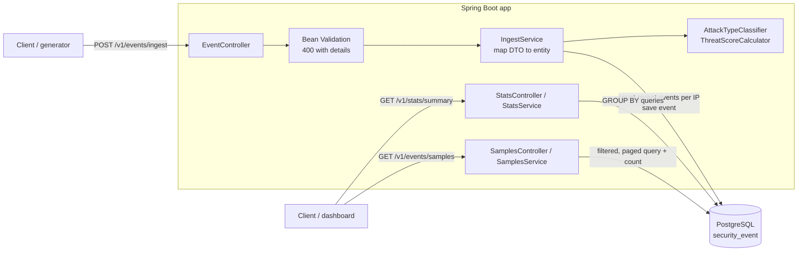

# Mini WSA – Mini Security Analytics Pipeline

A small Web Security Analytics service, that ingests security events (DLRs),
classifies and scores them, stores them in PostgreSQL, and exposes analytics through a REST API.

**Stack:** Java 21, Spring Boot 4, Spring Data JPA (Hibernate), Flyway, PostgreSQL 16, Bean Validation,
JUnit 5, Mockito, Testcontainers, Docker Compose.

---

## Contents

- [Quick start](#quick-start)
- [Build and run](#build-and-run)
- [API](#api)
- [Data generator](#data-generator)
- [Demo and check scripts](#demo-and-check-scripts)
- [Architecture](#architecture)
- [Storage choice](#storage-choice)
- [Design decisions](#design-decisions)
- [Testing](#testing)
- [What I would improve with more time](#what-i-would-improve-with-more-time)
- [Challenges and how I solved them](#challenges-and-how-i-solved-them)

---

## Quick start

### Requirements

| Tool | Needed for |
|---|---|
| Docker (Docker Desktop on Mac/Windows), running | The app and PostgreSQL |
| Java 21 | The data generator and `./mvnw test` (Maven itself is downloaded by `mvnw`) |
| `curl`, `python3` | The demo and check scripts (already on macOS and Linux) |

Ports **8080** (app) and **5432** (PostgreSQL) must be free.

### Run

```bash
# 1. Get the code
git clone https://github.com/chen-levin/mini-wsa.git
cd mini-wsa

# 2. Start PostgreSQL and the app (the first build takes a few minutes)
docker compose up -d --build

# 3. Send 10,000 generated events (60 attack waves + background traffic)
java generator/EventGenerator.java 10000 --send

# 4. Look at the results
./scripts/demo-cases.sh | less
```

The API is now on `http://localhost:8080`.

`docker compose up` reads `docker-compose.yml` in the current folder: it builds the app image from the
`Dockerfile` (the code is compiled inside Docker, so the app itself needs no local Java), starts the official
`postgres:16` image (which creates the `miniwsa` database and user on first start), waits until PostgreSQL is
healthy, then starts the app. On startup, Flyway creates the tables.

---

## Build and run

### Option 1: everything in Docker

```bash
docker compose up -d --build     # build the app image and start PostgreSQL + app
docker compose ps                # both services should be up, postgres "healthy"
docker compose logs -f app       # follow the app logs
docker compose down              # stop (keeps the data)
docker compose down -v           # stop and delete the data
```

The app waits until PostgreSQL is healthy, then Flyway creates or updates the schema on startup.

### Option 2: PostgreSQL in Docker, app with Maven (for development)

```bash
docker compose up -d postgres
./mvnw spring-boot:run
```

### Tests

```bash
./mvnw test
```

Docker must be running: the integration tests start a temporary PostgreSQL with Testcontainers.

---

## API

All errors use the same body:

```json
{ "status": 400, "error": "Validation failed", "details": ["[0].rule.severity: must not be null"] }
```

### `POST /v1/events/ingest`

Accepts **one event** or **an array of events**. Each event is validated, classified and scored, then stored
with a server-side `receivedAt`. A batch is stored all-or-nothing.

```bash
curl -H 'Content-Type: application/json' -d @scripts/examples/event.json http://localhost:8080/v1/events/ingest
```

```json
{ "ingested": 1 }
```

| Status | When |
|---|---|
| 201 | Stored |
| 400 | Missing or invalid fields, unknown enum value, bad timestamp, malformed JSON, empty array |

**Required fields:** `eventId`, `timestamp`, `configId`, `clientIp`, `hostname`, `path`, `method`, `statusCode`,
`rule.id`, `rule.severity`, `rule.category`, `action`.
**Optional:** `policyId`, `userAgent`, `rule.name`, `rule.message`, `geoLocation`, `requestSize`, `responseSize`.

Validation details name the exact event and field, e.g. `[1].rule.severity: must not be null` or
`[0].action: Cannot deserialize ... "BLOCK": not one of the values accepted ... [MONITOR, DENY, ALERT]`.

### `GET /v1/stats/summary`

| Parameter | Required | Meaning |
|---|---|---|
| `from`, `to` | yes | ISO-8601 time range, `[from, to)` |
| `configId` | no | Omitted = all configurations |

```bash
curl "http://localhost:8080/v1/stats/summary?configId=14227&from=2026-05-20T00:00:00Z&to=2026-05-21T00:00:00Z"
```

```json
{
  "configId": 14227,
  "timeRange": { "from": "2026-05-20T00:00:00Z", "to": "2026-05-21T00:00:00Z" },
  "totalEvents": 1523,
  "byCategory": {
    "INJECTION": { "count": 450, "avgThreatScore": 72.3 },
    "BOT": { "count": 380, "avgThreatScore": 45.1 },
    "...": "all 7 categories, 0 when none"
  },
  "byAction": { "DENY": 890, "ALERT": 433, "MONITOR": 200 },
  "topAttackers": [ { "clientIp": "203.0.113.42", "count": 87, "avgThreatScore": 81.2 } ],
  "topTargetedPaths": [ { "path": "/api/v1/login", "count": 234 } ]
}
```

- `topAttackers` and `topTargetedPaths`: top 10 by event count.
- All 7 categories and all 3 actions are always present (0 when there are no events).
- Averages are rounded to one decimal.
- 400 when `from`/`to` is missing, not a valid date, or `from` is not before `to`.

### `GET /v1/events/samples`

| Parameter | Default | Meaning |
|---|---|---|
| `configId`, `category`, `action` | – | Optional filters |
| `from`, `to` | – | Optional time range `[from, to)` |
| `limit` | 20 | Page size, 1–100 |
| `offset` | 0 | Events to skip |

```bash
curl "http://localhost:8080/v1/events/samples?category=INJECTION&action=DENY&limit=2&offset=0"
```

```json
{
  "total": 219,
  "limit": 2,
  "offset": 0,
  "events": [
    {
      "eventId": "evt-00132",
      "timestamp": "2026-05-20T14:32:10Z",
      "receivedAt": "2026-10-17T12:23:10.888Z",
      "configId": 14227,
      "clientIp": "203.0.113.42",
      "path": "/api/v1/login",
      "rule": { "id": "950001", "name": "SQL_INJECTION", "severity": "CRITICAL", "category": "INJECTION", "...": "..." },
      "action": "DENY",
      "geoLocation": { "country": "CN", "city": "Beijing" },
      "attackType": "SQL/Command Injection",
      "threatScore": 75,
      "...": "all other DLR fields"
    }
  ]
}
```

- Sorted newest first. `total` is the number of matching events, for pagination.
- Events come back in the same nested shape as the input, plus `attackType`, `threatScore` and `receivedAt`.
- 400 for `limit` outside 1–100, negative `offset`, unknown `category`/`action`, bad dates, or `from` not before `to`.

### Enrichment rules

| `rule.category` | `attackType` |
|---|---|
| INJECTION | SQL/Command Injection |
| XSS | Cross-Site Scripting |
| PROTOCOL_VIOLATION | Protocol Anomaly |
| DATA_LEAKAGE | Data Exfiltration |
| BOT | Bot Activity |
| DOS | Denial of Service |
| RATE_LIMIT | Rate Limiting |

**Threat score** (0–100):

| Part | Points |
|---|---|
| Severity | CRITICAL 40, HIGH 30, MEDIUM 20, LOW 10 |
| Action | DENY +20, ALERT +10, MONITOR +0 |
| Path contains `/admin` or `/login` | +15 |
| More than 5 events from the same `clientIp` in the 10 minutes before this event | +15 |
| Cap | 100 |

The repeat-offender window is based on the event's own `timestamp`, so generated or late events are scored
correctly. With these rules the maximum is 90, so the cap is a safeguard for future rules.

---

## Data generator

`generator/EventGenerator.java` is a single-file Java program (JDK only, no build) that creates realistic events:

- **Attack waves (30%)**: one IP from `198.51.100.x` hitting one path (`/login`, `/api/v1/login`, `/admin`, `/search`)
  with one burst-type rule (injection, bot, DoS, rate limit): 50 events, 5 seconds apart.
- **Background traffic (70%)**: random IPs (about 500 from `203.0.113.x` and `192.0.2.x`), paths, rules, sites and locations.
- All events fall within the last 6 hours and are sorted by time.

```bash
java generator/EventGenerator.java 10000 events.json      # write a JSON array to a file
java generator/EventGenerator.java 10000 --send           # POST to http://localhost:8080 in batches of 500
java generator/EventGenerator.java 10000 --send http://other-host:8080
```

10,000 events = 60 waves of 50 + 7,000 background events. Sending takes a few seconds.
All IPs are from ranges reserved for documentation.

---

## Demo and check scripts

Run from the project root, against a running app with generated data. They need `curl` and `python3`.

| Script | Purpose |
|---|---|
| `scripts/demo-api.sh` | Walkthrough of all three APIs: each curl command and its full response |
| `scripts/demo-cases.sh` | 17 stats and samples cases (filters, paging, empty results, errors) with full responses |
| `scripts/check-stats.sh` | 21 PASS/FAIL checks on the stats API (totals add up, sorting, zero-filling, 400s) |
| `scripts/check-samples.sh` | 24 PASS/FAIL checks on the samples API (paging, filters, enrichment, 400s) |
| `scripts/compare-ingest.sh` | Times the same events in one request vs in batches of 500 (empties the table first) |

Every printed command can be copied and run on its own. Set `BASE_URL` to target another host.

---

## Architecture



**Packages:**

| Package | Contents |
|---|---|
| `event` | Ingest endpoint, request DTOs (records), `SecurityEvent` entity, repository |
| `enrichment` | `AttackTypeClassifier`, `ThreatScoreCalculator`: pure functions, unit tested |
| `stats` | Summary endpoint, aggregation queries, response records |
| `samples` | Samples endpoint, filtered and paged queries, response records |
| `error` | `GlobalExceptionHandler`: one error format for all 400s |

**Ingest flow, per request:** validate every event (400 if any is invalid) → in one transaction, for each event:
classify, count events from the same IP in the previous 10 minutes, score, save → 201.

---

## Storage choice

**PostgreSQL**, one flat table, `security_event`.

- The queries are filters on config and time plus `GROUP BY` counts and averages: plain SQL that PostgreSQL does well.
- Reliable, well known, easy to run in Docker, well supported by Spring, Flyway and Testcontainers.
- Plenty for this assignment's data volume (tens of thousands of events).

**At real big-data scale** (billions of events), aggregations on one row-oriented table get slow. I would use a
**columnar store such as ClickHouse** (or Druid / Pinot): it reads only the columns a query needs, compresses well,
and is built for `GROUP BY` over huge event tables. I would also partition by time and expire old data.

### Schema

- **Flat table:** nested `rule` and `geoLocation` are flattened into `rule_*` and `geo_*` columns, so they can be
  filtered, grouped and indexed directly. Events are written once and only read, so this denormalization is safe.
- **Surrogate key** `id BIGINT` identity. `event_id` is stored but not unique (no deduplication yet).
- **Enums stored as VARCHAR**, validated in the application.
- **Timestamps as `TIMESTAMPTZ`**; the JSON `timestamp` is stored in `event_time` (avoids the SQL keyword).
- **Indexes match the queries:**
  - `(config_id, event_time)`: stats and samples filtered by config and time;
  - `(event_time)`: queries without a config;
  - `(client_ip, event_time)`: the repeat-offender count on every ingest.
- **Flyway** owns the schema (`V1` creates the table, `V2` adds enrichment columns); Hibernate only validates it.

---

## Design decisions

- **Synchronous ingestion.** The API enriches and stores before answering 201. Simple and consistent;
  see "more time" for the asynchronous version.
- **Repeat offenders inside a batch.** Events are saved one by one inside the transaction, so later events in the
  same batch count the earlier ones (a wave sent as one request is still detected). Each event is counted only
  against its own IP.
- **Half-open time ranges `[from, to)`**, so back-to-back ranges never count an event twice.
- **Zero-filled stats**: all 7 categories and 3 actions are always present, so clients get a stable shape.
- **Deterministic paging**: samples are ordered by `event_time DESC, id DESC`. The `id` tie-breaker keeps the order
  stable when many events share a timestamp, so pages never repeat or skip events.
- **Records for DTOs, a class for the entity.** Requests, responses and query rows are immutable records; the JPA
  entity is a class, since Hibernate needs a mutable, non-final type. The service maps between them, so the API
  contract and the schema can change independently.
- **Read endpoints** run in a read-only transaction: one connection per request, no dirty checking.

---

## Testing

32 tests, run with `./mvnw test`:

| Type | Tests | What |
|---|---|---|
| Unit | `AttackTypeClassifierTest`, `ThreatScoreCalculatorTest` | Every category mapping; every scoring rule and the "more than 5" boundary |
| Unit (Mockito) | `StatsServiceTest`, `SamplesServiceTest` | Zero-filling, rounding, open time range, nested mapping |
| Integration (Testcontainers) | `EventIngestIntegrationTest` | Single event and arrays, enrichment, repeat offenders per IP within a batch, 400s |
| Integration | `StatsSummaryIntegrationTest` | Exact numbers for known events, `[from, to)` edges, all configs, top-10 limit, 400s |
| Integration | `SamplesIntegrationTest` | Nested shape, newest first, paging with equal timestamps, all filters, 400s |

Integration tests run the real flow: HTTP (MockMvc) → validation → services → Flyway schema → PostgreSQL.

---

## What I would improve with more time

- **Asynchronous ingestion with Kafka.** The API validates, writes to Kafka and returns `202 Accepted`; workers
  enrich and store in micro-batches. Ingestion stays fast during attack floods and survives database outages.
  This needs idempotent writes, since delivery is at-least-once.
- **Idempotency / deduplication** with a unique `eventId`, so retries don't store events twice.
- **A faster repeat-offender counter.** Today it is one count query per event. Partitioning the stream by
  `clientIp` lets each worker keep a 10-minute window in memory (or in a Kafka Streams state store);
  Redis is the option when several services need the counts.
- **Faster large requests.** One request is one transaction, and before each count query Hibernate re-checks
  every event already saved in that request, so the work grows with the square of the request size: 10,000 events
  in one request take about 4–7 times longer than the same events in 20 requests of 500 (see the next section).
  - **Limit the events per request** (for example 1,000, otherwise 400). Clients send batches, as the generator
    does, and Hibernate's automatic cleanup at the end of each request keeps it fast. This alone is enough.
  - **Only if large requests must be supported:** every 500 events, call `flush()` (write the saved events to the
    database, inside the same transaction, not a commit) and `clear()` (make Hibernate forget them), so it never
    has more than 500 events to re-check.
- **Batch inserts.**  each event is inserted on its own, because the repeat-offender count reads earlier
  events from the database, so they must be saved before the next one is scored. With the counter in memory
  (previous point), the service could score all events of a request first and then insert them in one batch.
  This also needs sequence-generated ids, since Hibernate cannot batch inserts with `IDENTITY` ids.
- **Keyset (cursor) pagination for deep pages.** With `OFFSET`, the database reads and throws away every skipped
  event: page 50,000 of 20 reads about a million rows to return 20. With keyset pagination, each response includes a
  bookmark, the time and id of its last event (`"nextCursor": "11:40_5"`), and the client sends it back for the next
  page (`?limit=20&cursor=11:40_5`). The query asks for events older than the bookmark
  (`WHERE (event_time, id) < ('11:40', 5)`), so the index jumps straight there and every page is as fast as the
  first. New events also no longer shift the pages. The trade-off: no jumping to an arbitrary page number, only
  next page. The spec asks for `limit`/`offset`, which is fast enough at this data size.
- **A columnar store** (ClickHouse) and pre-aggregated stats for real scale.
- **Hide internal details** from parse error messages (Java class names), and a case-insensitive path check
  (today `/Admin` and `/wp-admin` don't get the `/admin` bonus).


---

## Challenges and how I solved them

- **Repeat offenders inside one batch.** Saving the whole batch with `saveAll` at the end meant events in the same
  request couldn't see each other, so an attack wave sent as one request never got the bonus. I save each event
  before scoring the next, inside one transaction, and added tests for a 7-event wave and for mixed IPs.
- **Keeping a batch all-or-nothing.** Saving events one by one raised a question: what if event 300 of 500 fails?
  Each repository `save()` runs in its own transaction by default, so events 1–299 would already be committed, and
  the client's retry would store them twice (there is no deduplication yet). I put `@Transactional` on
  `IngestService.ingest()`, so every `save()` joins one transaction: 500 INSERTs, one COMMIT, and a failure rolls
  the whole batch back. The repeat-offender count still sees the events saved earlier in the same request, because
  a transaction sees its own uncommitted rows.
- **Precise 400 errors for a batch.** In a batch of 500 events, a generic "Bad Request" doesn't tell the client
  which event or field is wrong. There are also two kinds of errors: validation errors (`@NotNull`, `@Size`) and
  parse errors (an unknown enum such as `"BLOCK"`, a bad timestamp), which happen before validation runs and throw
  a different exception. `GlobalExceptionHandler` handles both and returns the same format with the event index and
  field path, e.g. `[1].rule.severity: must not be null`; for parse errors the path is built from Jackson's error path.
- **An ambiguity in the spec: "the last 10 minutes" relative to what?** The repeat-offender rule doesn't say whether
  the window is based on the event's `timestamp` or on when the server received it. I chose the event's `timestamp`,
  since that is when the attack happened. Generated or late events are then scored correctly; with `receivedAt`, a
  generated batch would put thousands of events into the same few seconds.
- **Running the app in Docker.** Inside a container `localhost` is the container itself, so the app couldn't reach
  PostgreSQL with the URL from `application.yml`; docker-compose overrides `SPRING_DATASOURCE_URL` to use the
  service name `postgres`, while local runs keep `localhost`. The app could also start before PostgreSQL was ready
  and fail, so PostgreSQL has a `pg_isready` healthcheck and the app waits for `service_healthy`. Tests need Docker
  themselves (Testcontainers), so the image build skips them and they run with `./mvnw test`.
- **Optional time filters in PostgreSQL.** `(:from IS NULL OR e.eventTime >= :from)` failed with "could not determine
  data type of parameter" for a null timestamp. Instead of casts, the service replaces a missing `from`/`to` with
  very early and very late dates, so the query always has a time range and can use the index.
- **Large requests were slow.** The same 10,000 events took much longer in one request than in batches of 500:
  14 seconds vs 3 seconds on the app running in Docker (`./scripts/compare-ingest.sh`); . The exact times depend on the machine and on JVM warm-up, but one big
  request was always 4–7 times slower. The cause was Hibernate flushing and dirty-checking every saved entity
  before each count query, which grows quadratically. The generator sends batches; capping request size is listed
  above.
- **Stable paging.** Events with the same timestamp could swap between pages. Adding the unique `id` as a tie-breaker
  made the order deterministic, and a test pages through events with identical timestamps.
- **Realistic generated data.** Checking the generated data through the API showed two problems:
  - **Events in the future.** Some events had a `timestamp` later than their `receivedAt`. A wave picked a random
    start time anywhere in the last 6 hours and then added events every few seconds, so a wave starting near "now"
    ran a few minutes past it. Fix: every wave is 50 events, 5 seconds apart (250 seconds), and starts at least
    250 seconds before "now", so it always ends in the past.
  - **Normal traffic in the top attackers.** Background events used only 200 IPs, about 35 events each, so the
    busiest normal IPs had more events than a 50-event attack wave and appeared in `topAttackers`. Fix: about 500
    background IPs (two documentation ranges), about 14 events each, so the busiest stays far below 50 and the top
    attackers are always the attack waves.
